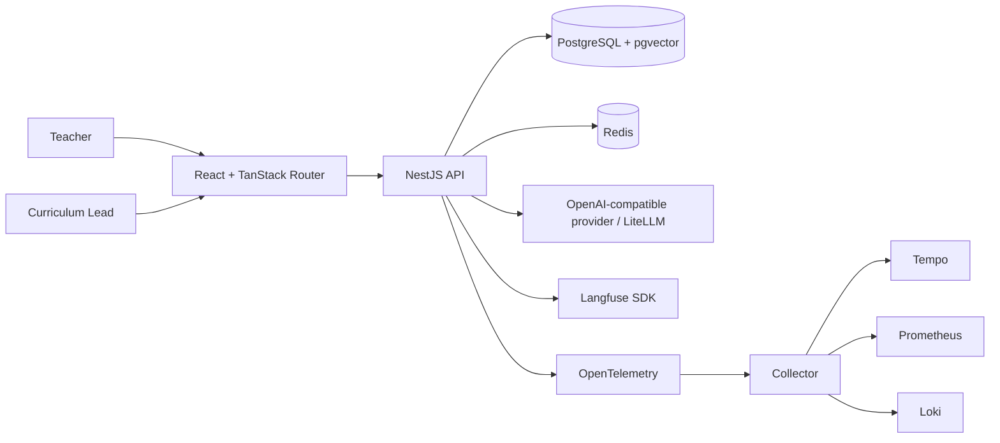

# Architecture

This page maps the running application for reviewers and contributors. The root
[README](../README.md) covers local setup and the demo flow.

## Runtime shape

## Code boundaries

- `apps/web` owns screens, forms, routing, and typed HTTP calls.
- `apps/api` owns authentication, authorization, HTTP validation, use cases,
  database access, retrieval, model calls, and workflow transitions.
- `packages/shared` owns Zod contracts shared across the API and web app.
- `packages/model-runtime` owns provider adapters used by the API. The API owns
  embedding and retrieval behavior.
- `apps/evals` calls the API for generation and validation, then exports
  evaluation run snapshots to Langfuse. It has no duplicate product workflow.

Database table definitions live in feature-oriented files under
`apps/api/src/database/schema`. Feature repositories use Drizzle. HTTP request
and response contracts live in `packages/shared` and are used to generate the
OpenAPI description and web client types.

## Workflows

See [workflow state charts](workflow-state-charts.md) for the implemented
lesson-plan lifecycle, generation and repair path, provider retries, standalone
rubric validation, and source revision publication. The shared package defines
allowed lesson-plan transitions; review decisions reference the exact immutable
version reviewed.

## Access policy

Protected product routes require authentication. Server-side role checks
protect role-specific writes.

| Action | Teacher | Curriculum Lead |
| --- | --- | --- |
| List plans | Own plans and published plans | Submitted and published plans |
| Read a plan | Own plans and published plans | Own, submitted, and published plans |
| Generate, edit, submit | Generate plans; edit own drafts or returned plans; submit own drafts | — |
| Run rubric QA | Any plan the user may read | Any plan the user may read |
| Return or publish | — | Submitted plans |
| Browse curriculum library | Published catalogue and sources | Published catalogue plus draft designs and source revisions/links |
| Add and publish curriculum sources | — | Yes |

Source intake accepts text and metadata through the API. It creates a resource
or a draft revision of an existing resource, chunks, and target link; a
separate action publishes the link. The web library does not expose source
management. Any authenticated user can read published plans.

## Change guide

When adding a workflow, define its contract in `packages/shared`, add the API
use case and persistence path, expose it through the controller, then connect
the web screen. Keep state changes and their version/review records in one
database transaction. Add telemetry at the AI workflow boundary only for
AI-related traces; ordinary HTTP and database traces remain in OpenTelemetry.
