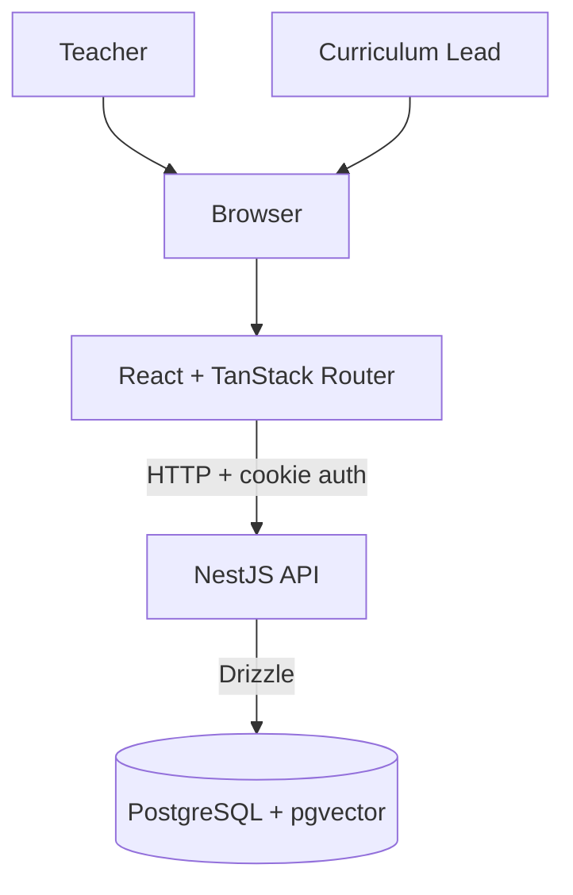
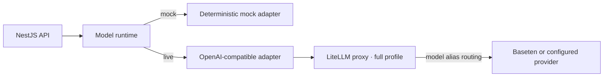
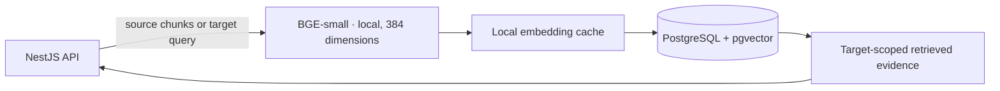

# Architecture

Use this page to locate services, code responsibilities, and access rules. See the [README](../README.md) to run the demo.

## Application path



## Model routing



The OpenAI-compatible adapter can call a provider directly. The full demo routes through LiteLLM for model aliases and provider routing.

## Embedding and retrieval



## Local services

The Compose profiles share one PostgreSQL service:

| Profile | Services |
| --- | --- |
| Lite | PostgreSQL, API, web |
| Full | Lite services plus LiteLLM, Langfuse, Redis, ClickHouse, MinIO, and the OpenTelemetry/Grafana stack |

PostgreSQL hosts separate Nova, LiteLLM, and Langfuse databases. Langfuse web and worker use Redis queues; the API does not use Redis as an application cache. See [observability](observability.md) for signal routing.

## Code map

The main directories own these responsibilities:

```text
apps/
  api/                 HTTP, authentication, policies, use cases, persistence, retrieval
  web/                 Screens, forms, routing, typed HTTP calls
packages/
  shared/              Zod request and response contracts
  model-runtime/       Provider adapters
```

Database tables live in feature files under `apps/api/src/database/schema`; feature repositories use Drizzle. Shared contracts produce the OpenAPI description and web client types. The API owns embedding and retrieval.

## Access rules

The API requires authentication, checks capabilities, then enforces plan ownership and workflow state. Web role guards choose the workspace; the API remains responsible for authorization.

| Action | Teacher | Curriculum Lead |
| --- | --- | --- |
| List or read plans | Own plans and published plans | Submitted and published plans |
| Generate | Yes | — |
| Edit | Own Draft or Returned plans | — |
| Submit | Own Draft plans | — |
| Delete | Own unreviewed Draft plans | — |
| Run rubric QA | Any readable plan | Any readable plan |
| Return or publish | — | Submitted plans |
| Browse library | Published catalogue and sources | Also draft designs and source revisions/links |
| Add or publish sources | — | Yes |
| Read or change LLM mode | Yes | Yes |

Source management is API-only; the web library does not expose those actions. Source intake creates a resource or revision, chunks, and a draft target link. Publication is a separate action. See [data flows](data-flows.md) for the workflow.

## Add a workflow

Follow the existing contract-to-screen path:

1. Define the request and response in `packages/shared`.
2. Add the API use case and repository operations. Commit state changes and their version/review records in one transaction.
3. Expose the controller route and connect the web client and screen.
4. Trace AI work at the AI workflow boundary. Keep ordinary HTTP and database spans in OpenTelemetry.
