# Architecture

## Package boundaries

```text
apps/web       React screens, form state, API requests
apps/api       NestJS auth, workflow, retrieval, generation, validation, persistence
packages/shared Zod lesson-plan schemas and transport types
apps/playground Internal corpus and model evaluation CLI; excluded from product walkthrough
```

The browser presents actions. The API checks identity, ownership, transitions, curriculum references, and lesson-plan invariants. Drizzle stores plans, immutable versions, reviews, curriculum chunks, and pgvector embeddings.

## Lesson-plan workflow

```mermaid
stateDiagram-v2
  [*] --> Draft: generate
  Draft --> Draft: teacher edits; save new version
  Draft --> Submitted: submit after QA
  Submitted --> Returned: lead returns with comment
  Submitted --> Published: lead publishes
  Returned --> Draft: teacher edits
  Published --> [*]
```



Only these transitions are valid. The API locks the plan row while changing state; an invalid action returns `409 PLAN_TRANSITION_INVALID` without changing the plan. A return needs at least eight non-space characters of feedback. A returned plan becomes Draft on its first edit, then needs another submit. Published plans are terminal.

| Current state | Action | Next state | Guard |
|---|---|---|---|
| Draft | Edit | Draft | Teacher owns the plan; content passes deterministic QA; save a new version |
| Draft | Submit | Submitted | Latest version passes deterministic QA |
| Submitted | Return | Returned | Lead decision; comment has at least eight non-space characters |
| Submitted | Publish | Published | Lead decision; latest version still passes QA |
| Returned | Edit | Draft | Teacher owns the plan; first edit creates a new version |
| Returned | Submit | Submitted | Latest edited version passes deterministic QA |

Every other state/action pair is rejected before mutation. State changes and version/review writes share a database transaction; concurrent decisions serialize on the plan row. Clients receive a stable error code and a message that names the next correction: `PLAN_TRANSITION_INVALID` (409), `REVIEW_COMMENT_REQUIRED` (400), or `LESSON_PLAN_QA_FAILED` (422 with failed checks). A returned plan cannot be silently republished: it must be edited and resubmitted.

Each teacher edit creates a new immutable version. Submit validates the latest version in the same transaction as the state change. QA requires a valid shared schema, activity minutes that sum to the lesson length, existing curriculum chunk references, and citations drawn from the generation run's frozen candidate set. Failures return `422 LESSON_PLAN_QA_FAILED` with the checks to fix.

Teachers can read their own plans and any published plan. Curriculum leads can read submitted plans. The lead queue contains submitted plans only. The web app clears the selected detail after a lead decision because returned and published plans leave that queue.

## Generation and grounding

The teacher selects a CBC outcome and lesson length. The API pins that outcome, retrieves related chunks by BGE-small embeddings and pgvector cosine distance within the same subject and grade, and sends the selected outcome plus candidate sources to an OpenAI-compatible provider. LiteLLM is the local gateway. The API validates output before saving a Draft; failed generation leaves no plan behind.

`LessonPlanGenerator` owns prompting, the single correction attempt, schema checks, and grounding checks. Configuration selects either the deterministic mock adapter or the OpenAI-compatible HTTP adapter; provider transport and response parsing stay behind that interface. Embeddings use a separate adapter. Local BGE weights live under `TRANSFORMERS_CACHE_DIR`; content-addressed vectors live under `EMBEDDING_CACHE_DIR`. The internal playground has its own evaluation workflows and does not control product plan state.

## Error behavior

API errors carry a stable `code`, useful message, and request ID. Workflow state and QA errors are listed above. Provider and embedding failures use `LLM_*` and `EMBEDDING_*` codes; unavailable generation returns a retryable service error without saving a draft. Logs and traces carry request and trace IDs, not provider keys.

## Telemetry

The API and LiteLLM emit OpenTelemetry signals. The Collector routes traces to Tempo and Langfuse; Prometheus scrapes metrics; Loki stores structured logs. LiteLLM owns provider routing, usage, cost, and budgets. Langfuse stores prompts, traces, and evaluations. See [observability.md](observability.md) and the [playground telemetry runbook](playground/telemetry-runbook.md).
