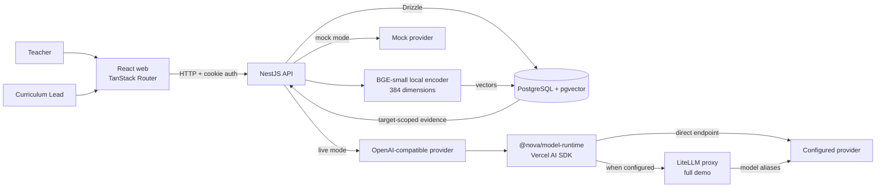
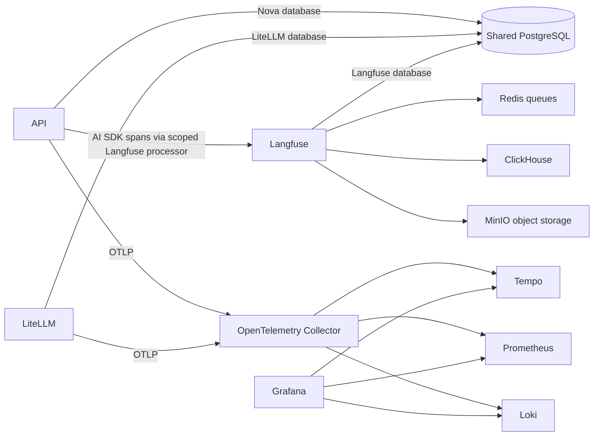

# Architecture

Use this page to trace runtime boundaries and find the code that owns a change. See the [data model](domain-model.md) for records and [data flows](data-flows.md) for workflow steps.

## Application and model route

## AI and service telemetry

The API creates AI observations with `@langfuse/tracing`; `LangfuseSpanProcessor` forwards only spans from the `langfuse-sdk` scope. Other API and LiteLLM signals go through the OpenTelemetry Collector.

## Demo modes

The demo commands select the core services or the full observability stack:

| Command | Services |
| --- | --- |
| `pnpm demo:up` | PostgreSQL, API bootstrap, API, and web. Uses mock AI. |
| `pnpm demo:full` | Core services plus LiteLLM, Langfuse, Redis, ClickHouse, MinIO, OpenTelemetry Collector, Tempo, Prometheus, Loki, and Grafana. |

The API bootstrap job runs migrations and seeds data before the API starts. Both modes default to deterministic mock AI. Mock output is visibly labelled and uses sub-strand scaffolds to exercise generation, source display, validation, and review. It does not measure lesson quality; use a live provider for that. In full mode, select Live and configure an OpenAI-compatible endpoint. `COMPOSE_LLM_BASE_URL` defaults to LiteLLM, which routes model aliases; set it to a provider endpoint to bypass the proxy. One PostgreSQL service hosts separate Nova, LiteLLM, and Langfuse databases. Redis serves Langfuse queues; the API stores rate-limit counters in PostgreSQL.

## Code ownership

Feature modules own their HTTP routes, use cases, and repositories. The API authorizes actions and enforces plan ownership and state transitions; web role guards shape navigation only.

| Code | Owns |
| --- | --- |
| `apps/web` | React screens, TanStack Router, and generated API client types. |
| `apps/api/src/common` | Request handling, authentication and policy guards, validation, errors, and security plumbing. |
| `apps/api/src/curriculum-library` | Curriculum catalogue, source lifecycle, and target-scoped retrieval. |
| `apps/api/src/lesson-planning` | Plan operations and the nested generation, validation, and rubric workflows. |
| `apps/api/src/database` | Drizzle schemas, database connection/executor, and CRUD primitives. |
| `apps/api/src/embeddings` | Local embedding adapter and cache. |
| `packages/shared` | Zod API contracts, permissions, and shared types. |
| `packages/model-runtime` | OpenAI-compatible model calls and provider error classification through the Vercel AI SDK. |

Shared workflow schemas are validated by the Standard Schema pipe and referenced in OpenAPI. The web API client types are generated from OpenAPI. See [observability](observability.md) for signal routing and trace details.
