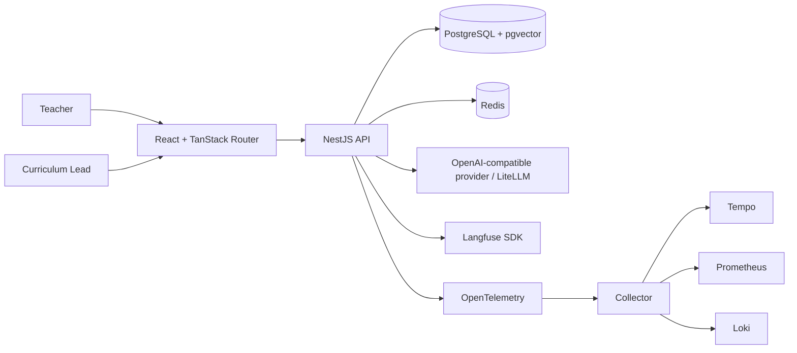

# Architecture

This page maps the running application for reviewers and contributors. The root
[README](../README.md) covers local setup and the demo flow.

## Runtime shape

## Code boundaries

- `apps/web` owns screens, forms, routing, and typed HTTP calls.
- `apps/api` owns authentication, authorization, HTTP validation, use cases,
  database access, retrieval, model calls, and workflow transitions.
- `packages/shared` owns Zod contracts shared across the API and web app.
- `packages/model-runtime` owns provider adapters used by the API. The API owns
  embedding and retrieval behavior.
- `apps/evals` calls the API for generation and validation, then exports
  evaluation run snapshots to Langfuse. It has no duplicate product workflow.

Database table definitions live in feature-oriented files under
`apps/api/src/database/schema`. Feature repositories use Drizzle. HTTP request
and response contracts live in `packages/shared` and are used to generate the
OpenAPI description and web client types.

## Lesson-plan workflow

```mermaid
stateDiagram-v2
  [*] --> Draft
  Draft --> Draft: Teacher edits; save immutable version
  Draft --> Submitted: Teacher submits
  Submitted --> Returned: Lead returns with comment
  Submitted --> Published: Lead publishes
  Returned --> Draft: Teacher edits; save immutable version
  Published --> [*]
```

The shared package defines the allowed transitions. The API checks role,
ownership, status, and deterministic content rules before committing changes.
Review decisions reference the exact immutable lesson version. A returned plan
must be edited and submitted again. Published plans are terminal.

Generation is a use case: resolve the selected curriculum target, retrieve its
eligible sources, call the configured provider, parse and validate the output,
then persist a Draft and its provenance. One corrective model attempt follows
deterministic validation failure. If both attempts fail, no plan is saved.

The teacher can run rubric QA separately on a saved version. Rubric QA is
advisory; deterministic checks govern workflow validity. A new edit creates a
new version, so QA attached to an earlier version remains an auditable result
for that version.

## Change guide

When adding a workflow, define its contract in `packages/shared`, add the API
use case and persistence path, expose it through the controller, then connect
the web screen. Keep state changes and their version/review records in one
database transaction. Add telemetry at the AI workflow boundary only for
AI-related traces; ordinary HTTP and database traces remain in OpenTelemetry.
