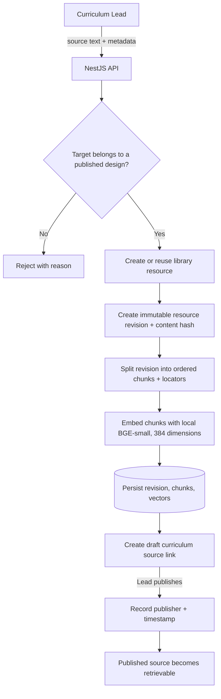
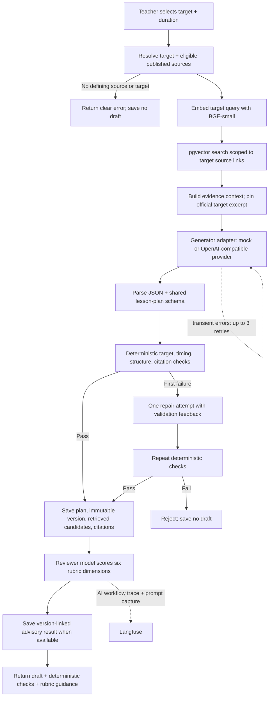
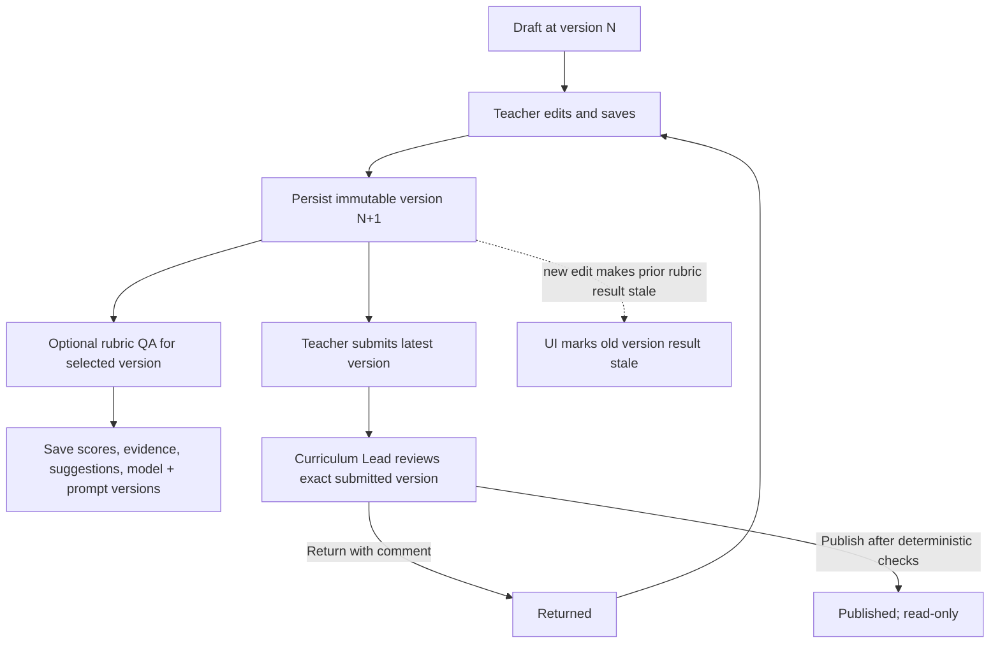

# Data flows

Follow the implemented source, generation, and review paths here. See the [data model](domain-model.md) for records and the [ingestion proposal](corpus-ingestion.md) for future file handling.

## Source intake and publication

A Curriculum Lead submits text and metadata through the API. Each update creates an immutable resource revision. Publishing its target link makes the source eligible for retrieval.

## Generate a grounded draft

The API retrieves published evidence for the selected target, requests schema-constrained lesson content, and runs deterministic checks before saving. Invalid output gets one repair attempt. Rubric QA runs after persistence and provides advisory guidance.

The failure outcomes are distinct:

- **Invalid lesson content:** one repair, then a clear error; no draft is saved.
- **Retryable provider failure:** up to three provider retries, then a clear error; no draft is saved.
- **Rubric failure:** the persisted draft remains available.

Generation and rubric traces carry request correlation. See [observability](observability.md) to inspect them.

## Edit, validate, and review

Saving an edit appends an immutable version. Rubric QA can assess any saved version and does not change plan status. Submission and publication run deterministic checks; the Curriculum Lead makes the publication decision.

Reviews and validations reference the exact version assessed. Later edits leave that history intact and make the prior rubric result stale in the UI.
