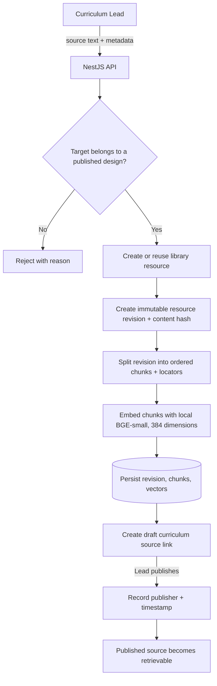
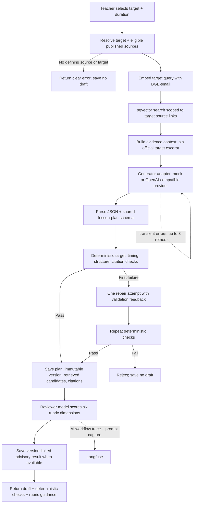
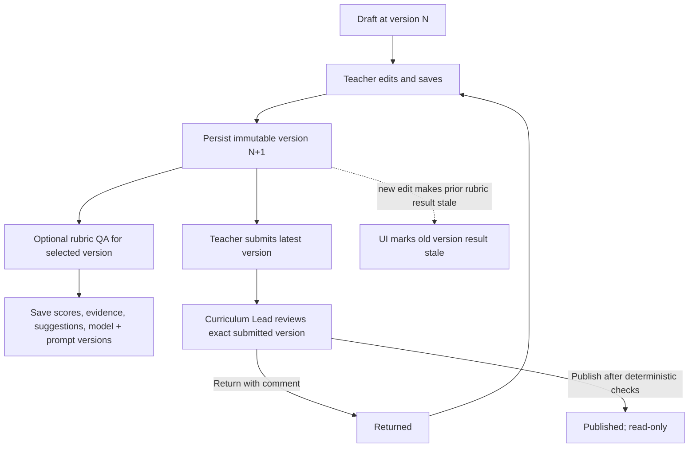

# Data flows

These diagrams follow the implemented source, generation, authoring, and review
paths. The [domain model](domain-model.md) lists the persisted entities and
attributes; the [architecture](architecture.md) shows the runtime services.

Zoomable workflow diagrams: [system diagram board](https://www.tldraw.com/f/bmp8NfBjhONWbeWKxZ7M9).

## Source intake and publication

Curriculum Leads submit source text and metadata through the API. Each update
creates a new immutable resource revision; publishing its target link makes the
source eligible for retrieval.

## Generate a grounded draft

The API retrieves published evidence for the selected target, asks the configured
provider for schema-constrained lesson content, and runs deterministic checks
before saving. One repair call follows a failed first response. Rubric QA runs
after draft persistence and is advisory.

Transport retries happen inside each provider completion call and respect
`Retry-After` with jitter. Generation and rubric QA have separate Langfuse
traces; each trace carries request correlation. Rubric failure does not undo the
persisted draft.

## Edit, validate, and review

Teacher edits create new immutable versions. Rubric validation can run against
any saved version. Submission and publication use deterministic checks; the
Curriculum Lead's decision remains the publication gate.

Review decisions and validation rows reference the exact lesson-plan version.
Rubric validation does not change plan status; submission and publication do.
