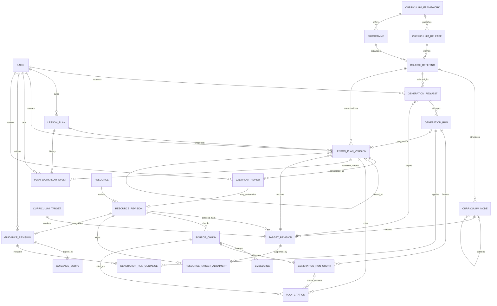

# Curriculum domain model

**Status:** focused proposal for a mock corpus and tabletop simulation; not an application schema.

## Decisions

- Model a CBC curriculum coordinate as **release + programme + curriculum level + subject offering + hierarchy + target revision**. Keep the school's local grade separate from the KICD level when a school mapping is supplied.
- Give each target a stable internal `targetId` and a release-specific `targetRevisionId`. Printed codes such as `1.2(a)` are external codes or locators, not global IDs. Keep external subject codes as strings (`0893` retains its leading zero).
- Model real resource types. Keep authority role, authorship, approval, and fixture origin as separate fields. `demo_seed` marks provenance; it does not make a document type. ISBN is optional publication metadata, not a resource, file, or curriculum revision ID.
- Make Curriculum Lead guidance versioned and scoped. Exemplar plans or sections need reviewed alignment and reuse permission; they can inform teaching craft, never establish curriculum authority.
- The performance brief uses embeddings for corpus retrieval and an LLM to draft after a teacher selects a target and duration. AI does not author or approve corpus resources. Mock mode should run the same workflow deterministically without credentials or cost.
- A Teacher owns one plan and edits the shared plan shape. Save each edit as a new immutable version. A Curriculum Lead approves or returns the exact submitted version; editing a returned plan returns it to Draft.

| Example | Framework / programme | Level / subject | Target type |
| --- | --- | --- | --- |
| Kenya CBC | KICD / Junior School | Grade 8 / Integrated Science | `specific_learning_outcome` |

## Proposed ERD

Curriculum and source records are versioned independently from lesson work. A generated plan version points to its run; every version points to its curriculum context and source-use links.



| Entity group | Fields that define the model |
| --- | --- |
| Framework, release, programme, offering | Authority and framework; release label, date, source and hash; programme; curriculum level, local-level mapping, subject label and external code. |
| `CurriculumNode`, `CurriculumTarget`, `TargetRevision` | Offering hierarchy; stable target identity; versioned statement, target type, external code, source revision/locator, and superseded revision. |
| `Resource`, `ResourceRevision` | Stable identity; type, authority role, authorship, approval, fixture origin, edition, source URL and content hash. |
| `SourceChunk`, `Embedding` | Revision, ordered text and locator; provider/model/version and vector. |
| `ResourceTargetAlignment` | Resource revision, target revision, review state and reviewer. |
| `GuidanceRevision`, `GuidanceScope` | Rule/clarification/recommendation, approval, rationale, optional structured predicate, author/approver; one explicit framework/release/programme/offering/target/school scope per row. |
| `ExemplarReview` | Source plan version, aligned target, review state, reuse permission and reviewer. |
| Request, run, run inputs | Teacher, offering, target, requested minutes and context snapshot; prompt/model-or-mock version and validation report; retrieved chunks and applied guidance with outcomes. |
| Plan, version, citation, workflow event | Owner and state; immutable content snapshot, origin, parent, target and optional run; section-to-chunk link; actor, action, exact reviewed version and comment. |

## Lesson-plan schema and authorship

One lesson plan is a teacher-ready session that helps learners work toward a selected curriculum target. It turns that target into a teachable objective, classroom activities, and a check for learning. It is not a copy of the curriculum target or a whole scheme of work.

```text
Lesson plan
├── Context · server-managed
│   └── Framework, release, level, subject, selected target, requested minutes
├── Lesson content · AI proposes; teacher edits
│   ├── Lesson objective(s)
│   ├── Materials
│   ├── Timed activities · teacher actions + learner actions
│   ├── Check for understanding · expected evidence
│   └── Source links on the sections they support
└── History · server + Curriculum Lead
    └── Versions, author, draft/submission state, review decision
```

**Lesson content fields:**

- `title` and `durationMinutes`: a name and total time for this session; the first AI draft must match the requested minutes.
- `lessonObjectives`: observable, teacher-facing aims derived from the selected official target. The target and its exact source wording stay in context; the model cannot replace them.
- `materials`: what the teacher and learners need; may be empty.
- `activities`: timed `starter`, `main` or `closing` steps, each with `teacherActions`, `learnerActions`, `objectiveIds` and `sourceChunkIds`.
- `checksForUnderstanding`: a question or task, expected evidence, linked objective and source chunks.
- `curriculumConnections` (optional): a KICD key inquiry question, competency, value or PCI. Store `kind`, `label`, `evidence`, `activityIds` and supporting chunks. Include one only when a planned activity gives learners a way to demonstrate it.
- `differentiation` and `safetyNotes` (optional): add when the lesson needs them. A `phaseLabel` may use CBC's 5E cycle; it is not required by the shared schema.

Example content for the Grade 8 particle target:

```json
{
  "title": "Particles in the three states",
  "durationMinutes": 40,
  "lessonObjectives": [
    { "id": "objective-1", "text": "Compare particle spacing and movement in solids, liquids and gases.", "sourceChunkIds": ["chunk-outcome"] }
  ],
  "materials": [{ "name": "Particle model cards" }],
  "activities": [
    { "id": "a1", "kind": "starter", "durationMinutes": 5, "teacherActions": "Show particle diagrams.", "learnerActions": "Compare them and predict what differs.", "objectiveIds": ["objective-1"], "sourceChunkIds": ["chunk-outcome"] },
    { "id": "a2", "kind": "main", "durationMinutes": 25, "teacherActions": "Guide groups as they model particles.", "learnerActions": "Model and explain each state.", "objectiveIds": ["objective-1"], "sourceChunkIds": ["chunk-teaching-note"] },
    { "id": "a3", "kind": "closing", "durationMinutes": 10, "teacherActions": "Ask learners to justify one model.", "learnerActions": "Name evidence for spacing and movement.", "objectiveIds": ["objective-1"], "sourceChunkIds": ["chunk-outcome"] }
  ],
  "checksForUnderstanding": [
    { "id": "check-1", "prompt": "Which model represents a gas? What is your evidence?", "expectedEvidence": "Learner refers to particle spacing and movement.", "objectiveIds": ["objective-1"], "sourceChunkIds": ["chunk-outcome"] }
  ]
}
```

The model returns this `content` shape and chunk IDs only. The server adds the version envelope: plan/owner IDs, creator, version number, parent version, origin, selected curriculum offering and target revision, requested duration, and optional generation run. It resolves chunk IDs to real source references and rejects model citations outside the run's frozen context. A teacher may retain those citations or add explicitly selected, approved, in-scope chunks.

The AI creates the first draft; the Teacher owns and edits it. Each edit creates a new immutable version. A manual plan starts with `origin=teacher_authored`; a generated version starts with `origin=ai_draft`; a teacher edit uses `origin=teacher_edit`. The Curriculum Lead's decision and comment live in workflow history and attach to the exact submitted version.

**Mechanical rules:** the selected target belongs to the offering; each objective links to that target; every activity/check refers to an objective; activity minutes sum to lesson duration, which matches the request on an AI draft; and each AI citation belongs to the frozen retrieval set. Teacher-added citations must be explicitly selected, approved and in scope. These checks cannot prove that an objective meaningfully derives from the target or that a cited passage supports a claim; semantic QA and the lead review those meanings.

## Grounding invariants

1. The offering, release, level, subject, hierarchy and target revision form one valid curriculum context.
2. Retrieval uses approved, in-scope resource revisions. An exemplar alone cannot ground an official curriculum target.
3. Freeze the exact retrieved chunk IDs, locators, resource revisions, guidance revisions, prompt version and model/mock version on each run.
4. Validate required fields, selected target, objective links, AI citation membership in the frozen run, duration totals and structured mandatory rules mechanically. Teacher-added citations must be explicitly selected, approved and in scope.
5. Every section's source chunks must match the role of its claim. Missing curriculum support is a visible grounding gap, not a successful draft.
6. Scope and citation checks prove traceability, not entailment. A human lead reviews subject accuracy, age fit, feasibility and safety before publication.
7. Plan versions are immutable. Submission and review attach to one exact version; edits create a new version and require resubmission.

## Tabletop simulation

Use the focused [tabletop fixture, schema, prompts, QA indicators and verification loop](tabletop-simulation.md), with its [visual walkthrough](tabletop-simulation.html). It defines one Grade 8 Integrated Science offering, three target revisions, four plans, and a nine-document mock corpus. The performance brief's explicit AI step is generation; post-draft AI review/Jev and no-AI authoring are proposed extensions.

## References

- [Performance task brief](../nova-fullstack-performance-task.pdf)
- [Project glossary](../GLOSSARY.md)
- [KICD Grade 8 Integrated Science design, April 2024](https://kicd.ac.ke/wp-content/uploads/2024/06/Integrated-Science-Grade-8-Design-Formatted-April-2024.pdf)
- [International ISBN Agency: ISBN assignment](https://www.isbn-international.org/node/88)
