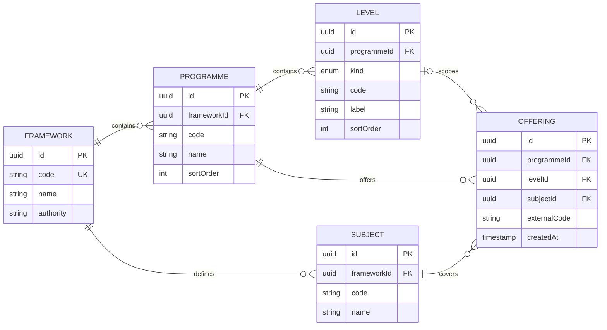
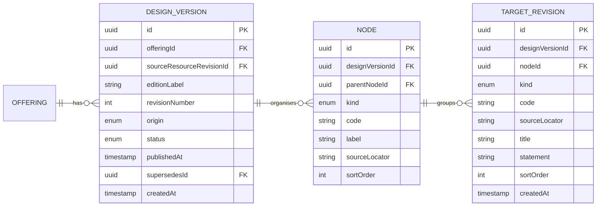
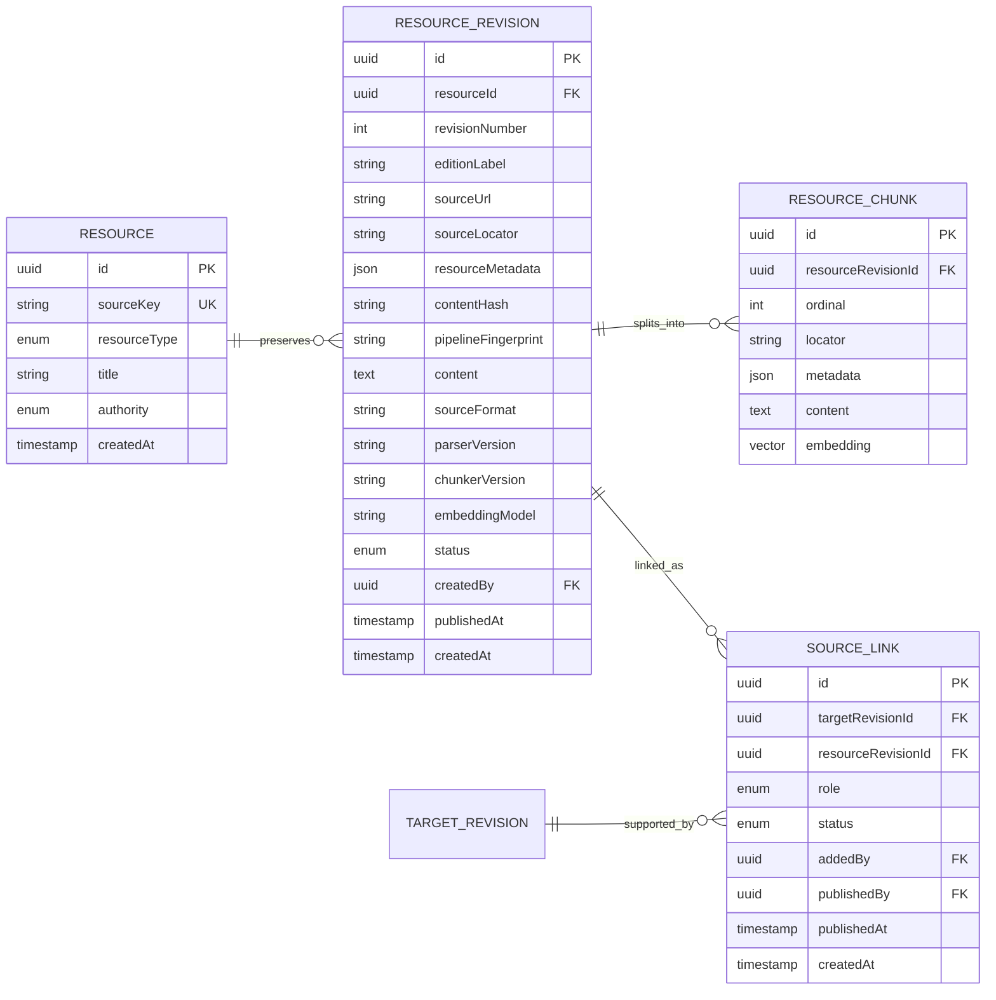
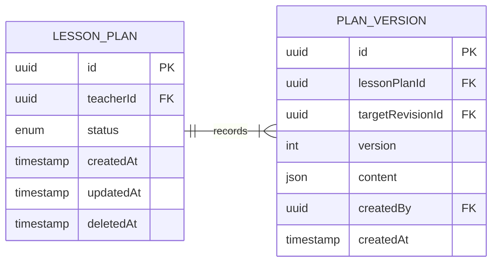

# Data model

The model separates curriculum structure, source evidence, and lesson-plan history. A **curriculum design** is an official subject guide published by an authority, such as [KICD's CBC designs](https://kicd.ac.ke/cbc-materials/curriculum-designs/regular-curriculum-designs/); a lesson plan is a teacher's plan for a target within that guide. `PK` and `FK` mark keys. Nullability is called out below.

## Catalogue



An **offering** joins a programme, subject, and—when applicable—a grade or level. These catalogue records describe the path; they are not curriculum content nodes. `levelId` and `externalCode` are optional.

| Catalogue record | Example |
| --- | --- |
| Framework | Kenya Competency Based Curriculum (CBC) |
| Programme | Junior School |
| Level | Grade 8 |
| Subject | Integrated Science |
| Offering | Junior School · Grade 8 · Integrated Science |

## Versioned curriculum content



An **edition** names a curriculum release; a **revision** records a corrected import of that release. Each offering has a unique edition/revision pair. The design source revision, `publishedAt`, and `supersedesId` are optional. Node `parentNodeId`, `code`, and `sourceLocator`, plus target `code`, are optional; a target's `sourceLocator` is required. `parentNodeId` makes the strand/sub-strand/topic tree. Composite foreign keys keep each node and target inside one design version. The app currently does not freeze a published tree against edits; see the [ingestion extension](corpus-ingestion.md).

For the Grade 8 Integrated Science offering above, the content tree starts at a design version. The offering identifies the catalogue path; nodes organize the curriculum content inside that version.

```text
Offering: Kenya CBC / Junior School / Grade 8 / Integrated Science
└── July 2024 · revision 1
    └── Strand 1 — Mixtures, Elements and Compounds
        └── Sub-strand 1.1 — Elements and compounds
            └── Outcome 1.1(a) — Differentiate between atoms, elements, molecules and compounds
```

## Source evidence



The link is many-to-many: one target can use several source revisions, and one source revision can support several targets. Catalogue paths (framework, programme, level, subject, offering) exist independently of design versions, targets, and sources. Targets belong to a design version; sources link to targets as evidence and are not catalogue fields. Generation requires a target and its published defining source link. Resource revision edition label, URL, locator, metadata, creator, and publication time may be absent; chunk locator is optional and typed metadata defaults to an empty object. Metadata can hold kind, heading path, outcome or assessment item codes, weekly-plan fields, marks, source lines, printed/PDF page ranges, and extension attributes. Only published links are retrievable. Embeddings are 384-dimensional vectors; chunks retain their source revision, locator, and metadata.

## Lesson plans and audit history



An edit appends a plan version. `deletedAt` and a version's `targetRevisionId` are nullable. Generated versions pin their target and cite source chunks.

| Related record | Key fields | Relationship and purpose |
| --- | --- | --- |
| `lesson_plan_retrieval_candidates` | `id`, `lessonPlanId`, `resourceChunkId`, `createdAt` | Evidence retrieved for the plan. |
| `lesson_plan_version_sources` | `id`, `lessonPlanVersionId`, `resourceChunkId`, `createdAt` | Chunks cited by that saved version. |
| `plan_reviews` | `id`, `lessonPlanId`, `lessonPlanVersionId`, `curriculumLeadId`, `decision`, `comment?`, `createdAt` | Lead decision and feedback for an exact version. |
| `lesson_plan_validations` | `id`, `lessonPlanId`, `lessonPlanVersionId`, status, rubric/prompt versions, model, summary, dimensions, trace ID?, `createdAt` | Rubric QA result for an exact version. |

Review and validation use a composite foreign key so their version must belong to the stated plan. Later edits do not change the version that was reviewed or scored.

The shared lesson content JSON has: title, subject, grade, learning outcome, duration, objectives, materials, starter, timed activities, check for understanding, and cited sources. Deterministic QA results are returned with the workflow; rubric QA is stored separately.

`users` supplies teacher, lead, and attribution references. Authentication sessions and rate-limit counters support the application but are outside this product model.
