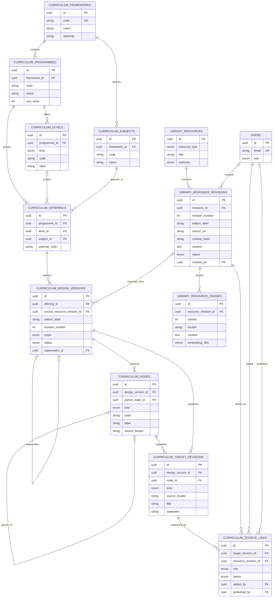
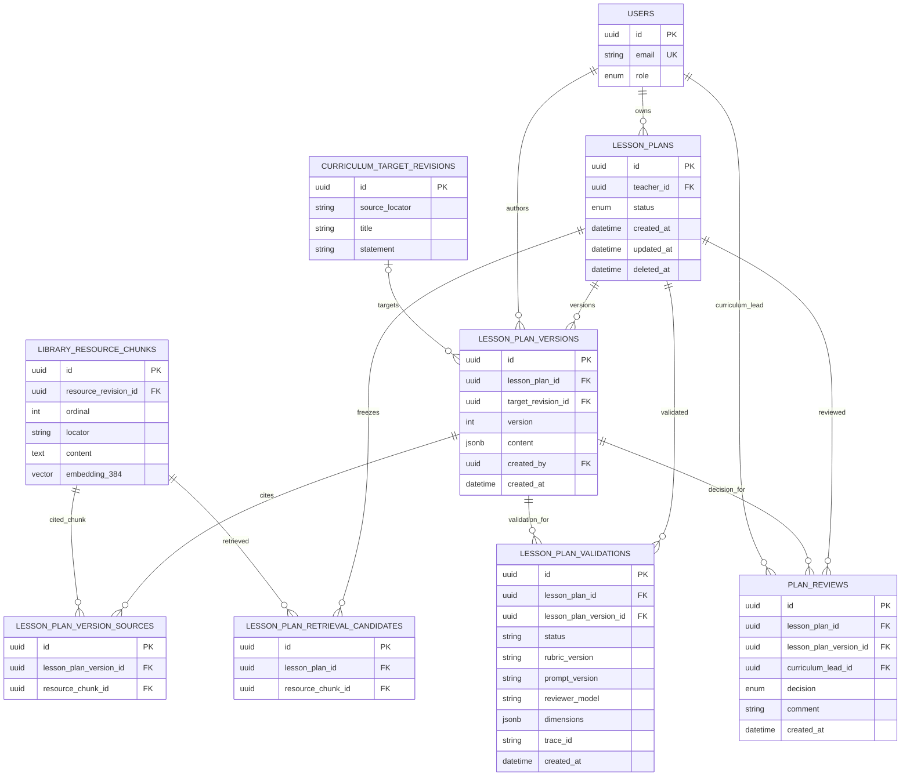

# Domain model

This reference describes the implemented Kenya CBC slice. The database schema
files under `apps/api/src/database/schema` and contracts under
`packages/shared/src/contracts` are authoritative.
The diagrams highlight key fields; the schema files define every column and
constraint.

Zoomable entity diagrams: [system diagram board](https://www.tldraw.com/f/bmp8NfBjhONWbeWKxZ7M9).

## Curriculum catalogue

```text
Framework → Programme → Level + Subject → Offering → Design version
                                                   ├→ Curriculum nodes
                                                   └→ Target revisions
```

Frameworks, programmes, levels, subjects, offerings, and design versions are
separate records. A design version owns its hierarchy and target revisions.
Publisher locators such as `1.2(a)` are meaningful within that version; Nova
UUIDs identify records but do not replace source codes or locators.

Curriculum nodes represent hierarchy such as strands, sub-strands, topics, and
sections. A target revision stores the teachable statement, kind, and locator.
The selected target revision is attached to each lesson plan version.

The demo catalogue includes multiple CBC paths. Grade 8 Integrated Science,
July 2024, target `1.2(a)` is the source-backed generation path. Other seeded
paths demonstrate catalogue browsing.

### Catalogue and source tables

The catalogue separates reusable framework, programme, level, and subject
records from each edition's hierarchy and teachable target revisions.



The source-link table is the many-to-many join between a target revision and a
resource revision. Its role and publication state determine whether a source
can support retrieval. `curriculum_nodes.parent_node_id` models nested strands,
sub-strands, topics, and sections inside one design version.

## Source library and grounding

```text
Library resource → immutable resource revision → chunks + embedding
                                             └→ curriculum source link
Lesson plan ─────→ retrieval candidate chunks
Lesson version ──→ cited chunks
```

Resources have a type and authority. Revisions have content, edition, hash, and
publication state. Chunks belong to one revision and store 384-dimensional
BGE-small vectors. Curriculum source links connect resource revisions to
curriculum targets with a role, such as `defines_target`, `lead_guidance`, or
`exemplar`. Lesson-version citations point to individual chunks.

Retrieval scopes to the selected target and its published eligible sources. It
pins the official target-defining material and selects supporting chunks. The
lesson plan stores the candidate set from generation; each lesson version
stores its citations. Candidate membership is shared across edits to that
plan. Link and revision records have a `retired` status, and retrieval only
uses published records. No source-retirement action is exposed through the API;
existing plan candidates and citations remain stored if a record's status
changes.

The web library browses catalogue content. Curriculum Leads can submit source
text and metadata through the API; this creates a draft resource revision,
chunks, and target link. A separate API action publishes the link. File upload,
extraction, and source-management screens are not implemented.

## Lesson plan content

The shared `LessonPlanContentSchema` validates both generated drafts and
teacher edits. Each immutable version stores:

- Title, subject, grade, and selected learning outcome.
- Lesson duration and measurable objectives.
- Materials and starter activity.
- Timed activities.
- Check for understanding.
- Source citations, each identifying a document and chunk.

The API checks schema validity, selected target values, requested duration,
activity-time total, unique citations, the official target citation, and
membership in the frozen retrieval set. These checks establish structure and
provenance; they do not prove that every instructional claim follows from its
citation.

## Versions, decisions, and validation

`lesson_plans` stores the owner, current state, and optional `deleted_at`.
Teachers can remove unreviewed drafts from their workspace; soft deletion keeps
their immutable versions. Plans with review history, in review, returned, and
published plans stay visible for audit. Each edit creates a new `lesson_plan_versions`
row with a content snapshot and exact target revision.
Retrieval candidates and cited sources are stored against the relevant version.
Each review row references the exact version the Curriculum Lead decided on.

Rubric QA also references an immutable lesson version. It records its status,
rubric and prompt versions, reviewer model, summary, six scored dimensions,
evidence, suggestions, trace ID, and timestamp. The six dimensions are outcome
alignment, objective measurability, activity alignment, assessment quality,
pacing feasibility, and source support. QA results do not change workflow state.

### Lesson-plan and audit tables

The plan row owns the workflow state; immutable versions hold the content. Review
decisions and rubric validations point to the exact version they assessed.



The current plan version is selected by its highest version number; the plan row
does not store a separate current-version pointer. Retrieval candidates are
frozen per plan, while citations are recorded per version. Reviews and
validations use a composite foreign key so their version must belong to the
same plan.

Teachers author and edit their own plans. Curriculum Leads review submitted
plans. State transitions and guards are shown in the
[workflow state charts](workflow-state-charts.md).
