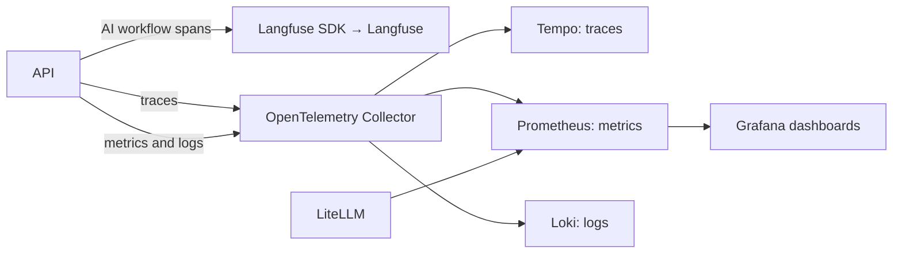

# Observability

This page explains where to inspect lesson-plan AI runs and system health. Run
`pnpm demo:full` to start the full telemetry stack and
`pnpm demo:check:full` to print its health and URLs. For app-only testing, use
`pnpm demo:up`; that mode does not start Langfuse or the OpenTelemetry stack.

## Where signals go

Langfuse receives lesson-plan generation and rubric-QA traces through its SDK.
The Collector sends distributed traces to Tempo, metrics to Prometheus, and
structured logs to Loki. Grafana displays metrics. LiteLLM reports provider
usage, cost, and budgets for proxied calls.

`pnpm demo:check:full` prints service URLs. The full-stack endpoints include
Grafana at `http://localhost:3000`, Langfuse at `http://localhost:3002`,
LiteLLM at `http://localhost:4000/ui`, Prometheus at
`http://localhost:9091`, Tempo at `http://localhost:3200`, and Loki at
`http://localhost:3100/ready`.

## AI workflow trace

Generation creates a `curriculum.lesson_plan.generate` Langfuse trace. It
records the selected target, retrieved source context, model request and
response, deterministic checks, correction attempt, usage, reported cost, and
final result. Rubric validation uses a separate
`curriculum.lesson_plan.qa.rubric` trace and records the exact plan version,
rubric/prompt versions, reviewer model, structured result, and status.

Request IDs propagate as searchable Langfuse metadata and to the provider as
`X-Request-Id`. W3C trace context preserves distributed trace correlation.
Provider attempts, retry outcomes, latency, token counts, and reported cost
also feed bounded-cardinality metrics. Plan IDs, target IDs, and request IDs
stay on traces rather than metric labels.

Prompt input/output capture is enabled by default through
`LANGFUSE_CAPTURE_PROMPTS=true`. Prompt bodies can contain curriculum excerpts
and generated lesson content. Set it to `false` in `.env.local` to turn capture
off. Lite mode does not export traces to Langfuse.

## Prompt management

The API uses Langfuse prompts named `nova-lesson-plan-generate` and
`nova-lesson-plan-rubric-review`. `LANGFUSE_PROMPT_LABEL` selects the label,
which defaults to `production`. The prompt's Langfuse model config can select
the LiteLLM model alias; otherwise the API uses its configured generator or
reviewer model.

`pnpm demo:full` creates missing prompts without overwriting existing edits. Use
`pnpm langfuse:prompts:sync` to add missing prompts. Use
`pnpm langfuse:prompts:publish` to publish code-defined prompt changes. If
managed prompts are disabled or unavailable, the API uses its source prompt
fallback.

## Reading the signals

- Use Langfuse to inspect prompt versions, model inputs and outputs, rubric
  results, and workflow failures.
- Use LiteLLM to inspect proxy spend, model routing, and budgets.
- Use Grafana to compare request volume, latency, generation outcomes, QA
  failures, correction attempts, tokens, and reported cost.
- Use Tempo for API and infrastructure spans outside the AI-specific Langfuse
  view; use Loki for correlated service logs.

Deterministic QA verifies structure, target, timing, and citation provenance.
Rubric QA offers model-generated guidance; it does not decide whether a plan
can be submitted or published. Human Curriculum Lead review remains the
publication decision.
