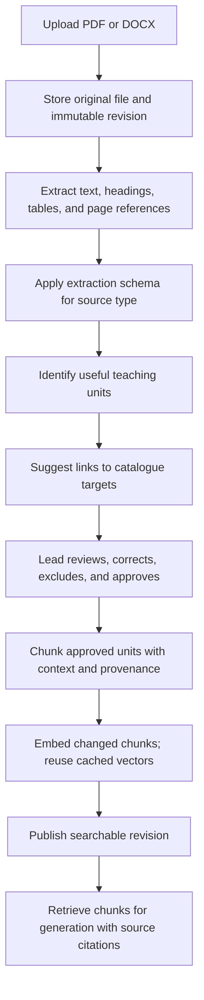

# Source ingestion pipeline extension

**Status: future extension.** The current curriculum library is browse-and-inspect only. Seed and import paths populate the catalogue; the UI has no source authoring, revision, or publish controls. This note records a possible ingestion workflow and must not be read as implemented behavior.

## Authoring experience

In a future version, start from a selected curriculum path or target. Choose **Upload document** or **Choose existing library source**. The system extracts text, page references, and curriculum structure, then presents a review preview.

The curriculum lead corrects uncertain matches, excludes irrelevant sections, and approves the extraction. Source text and locators belong in that preview. A later version may support pasted excerpts for short notes or guidance.

## Pipeline



Keep the complete original document for audit and page previews. Index approved teaching units. A meaningful unit is the extraction boundary; chunking divides a unit only when its size requires it.

## Extraction by known source type

| Source type | Useful unit | Context to retain |
|---|---|---|
| Curriculum design | Specific learning outcome | Edition, grade, subject, strand, sub-strand, source code |
| Scheme of work | Lesson or week entry | Outcome, sequence, duration, suggested activities |
| Assessment | Question with answer or marking guidance | Assessed outcome and expected evidence |
| Teaching note | Explanation, example, or misconception | Topic and applicable outcomes |
| Lead guidance | Rule or recommendation | Scope, authority, mandatory or advisory |
| Approved lesson exemplar | Activity or assessment section | Reviewed plan version, target, teaching purpose |

Preserve semantic relationships: keep a question with its answer, attach parent headings to outcomes, and retain table headers with rows. Exclude repeated headers, footers, contents pages, and unrelated administrative material from the retrieval index.

## Review preview

```text
Grade 8 / Integrated Science / July 2024

Uploaded: Grade-8-Integrated-Science.pdf
Detected type: Curriculum design                  [Change]

✓ 1.0 Mixtures, Elements and Compounds
  ✓ 1.2 Physical and chemical changes
    ✓ Outcome (a): Describe the characteristics…
      Page reference extracted · existing target matched
    ⚠ Outcome (b): Confirm suggested target

[Preview original page]  [Exclude selected]  [Approve extraction]
```

Generate page references automatically and let the lead correct them. Suggest document title and edition when evidence exists. Inherit the selected curriculum path; ask for confirmation when the document contradicts it. Show uncertain extraction and mapping explicitly.

## Proposed data shape

```text
Library resource
└── Immutable resource revision
    ├── Original file + checksum
    └── Ingestion run: extractor/schema version + state + issues
        └── Extracted unit: kind + text + provenance + review decision
            ├── Links to known curriculum target revisions
            └── Approved retrieval chunks + embeddings
```

An extracted unit records its meaning and origin separately from its embedding representation. For example:

```json
{
  "resourceRevisionId": "RESOURCE_REVISION_ID",
  "kind": "learning_outcome",
  "text": "Describe the characteristics of particles in the three states of matter.",
  "provenance": {
    "page": 14,
    "headingPath": ["1.0", "1.2"],
    "sourceCode": "(a)"
  },
  "targetRevisionIds": ["TARGET_REVISION_ID"],
  "reviewStatus": "approved"
}
```

The IDs and page number are illustrative. Store verified page references from the uploaded file.

## States and validation

```text
Uploaded → Extracting → Needs review → Approved → Indexing → Ready
                 ↘ Failed                         ↘ Failed
```

Each failed stage records an actionable code and supports retry from that stage. An indexing failure must not expose a partially indexed revision to generation. A scanned document enters an explicit **OCR required** state when text extraction cannot read it.

Extraction tools or an LLM can suggest units and catalogue links. Deterministic checks enforce required fields, known catalogue IDs, valid source/page references, duplicate detection, and complete chunk/vector writes. The lead confirms uncertain mappings and source authority. Structural validation alone does not establish curriculum accuracy.

## Versioning and embedding rules

- Preserve the original file, approved extraction, and cited chunks for each immutable revision.
- Create another revision when source content changes; keep historical lesson citations resolvable.
- Cache embeddings by normalized chunk content and the complete embedding pipeline identity: model, model revision, dimensions, and preprocessing/chunking version.
- Reuse vectors for unchanged representations. Re-embed changed chunks or the full affected index when the embedding pipeline changes.
- Filter retrieval by approved curriculum links and searchable revision state before ranking.
- Publish the revision only after all approved chunks are indexed successfully.

## Suggested first implementation slice

Support text-based PDF upload, extraction schemas for the known source types, source-page preview, target-link confirmation, and approval before indexing. Include one complete upload-to-retrieval path before adding OCR or broader format support.

Verify that an approved excerpt can be retrieved and cited back to its original page; failed extraction preserves the upload; retry does not duplicate units; and a replacement revision leaves older lesson citations intact.
