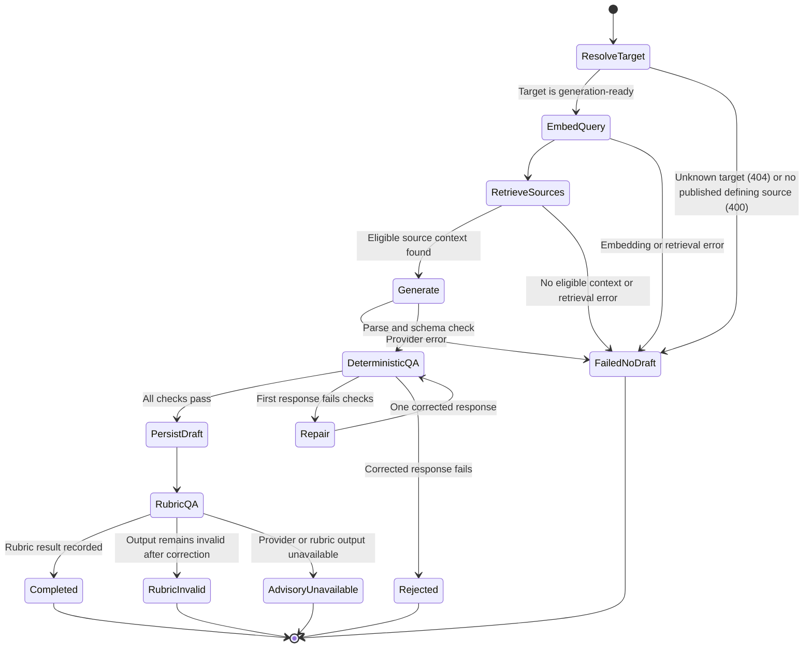
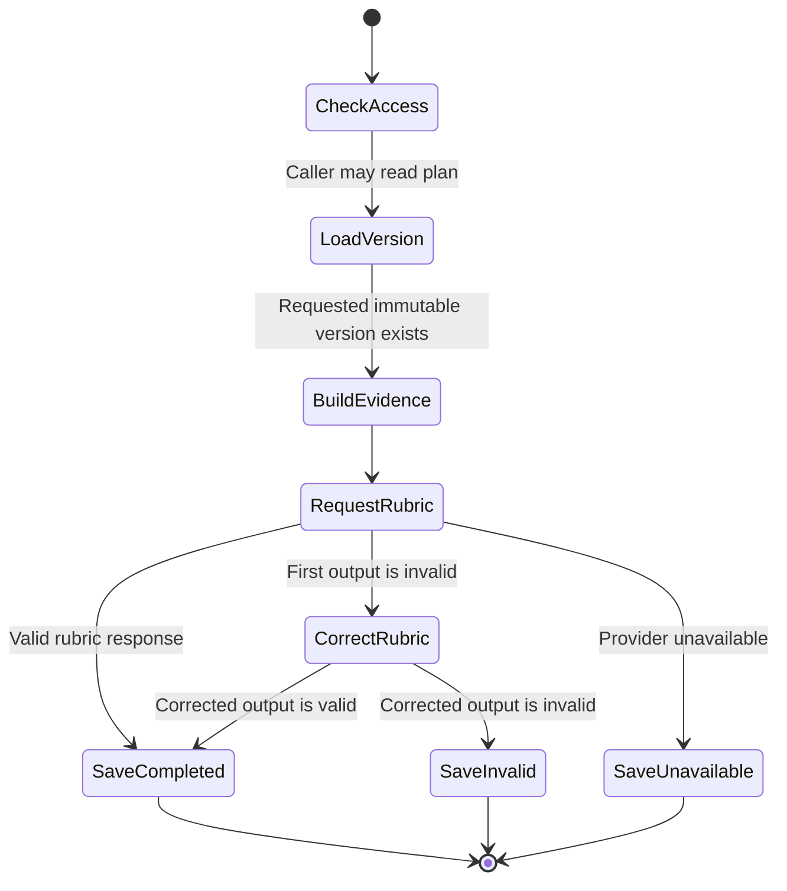

# Workflow state charts

These charts describe the implemented API behavior. Plan lifecycle, generation,
and rubric validation are separate flows: rubric results never change plan
status.

## Lesson-plan lifecycle

```mermaid
stateDiagram-v2
  [*] --> Draft: Generate valid plan and persist v1
  Draft --> Draft: Teacher edits; persist next version
  Draft --> Submitted: Teacher submits latest version
  Submitted --> Returned: Lead returns with meaningful comment
  Submitted --> Published: Lead publishes after deterministic QA
  Returned --> Draft: Teacher edits; persist next version
  Published --> [*]
```

The API checks role, ownership, current status, and deterministic content rules.
Invalid actions return `PLAN_TRANSITION_INVALID` (409). A returned plan must be
edited before it can be submitted again. Published is terminal. Review decisions
reference the immutable version reviewed; edits create a new version.

## Generate a draft

Deterministic QA checks the target, duration, activity timings, citation
uniqueness, official target citation, and that citations belong to the frozen
retrieval candidates. A failed first response gets one content-repair attempt;
failure after repair saves no draft. A valid draft and its provenance are
persisted before initial rubric QA. Initial rubric results can be completed,
invalid, or unavailable. Rubric QA is advisory. Its scores do not block saving,
submission, or publication.

Provider transport retries happen inside each completion call, before that
call returns success or error. The provider makes one initial attempt and up to
three retries for transient failures; it respects `Retry-After` with jitter.
Permanent errors and exhausted retries end the call.

## Validate a saved version

`POST lesson-plans/:id/validate` runs rubric QA for the requested version. It
does not rerun deterministic QA or change the plan lifecycle. Results record
the version, rubric/prompt version, reviewer model, trace ID, and timestamp.
The web UI marks a result stale when the plan has since advanced to another
version.

## Add and publish a curriculum source

```mermaid
stateDiagram-v2
  [*] --> DraftSourceLink: Curriculum Lead submits source text and metadata
  DraftSourceLink --> PublishedSourceLink: Lead publishes link after checks pass
  DraftSourceLink --> DraftSourceLink: Publish rejected; link stays draft
  PublishedSourceLink --> [*]
```

The source endpoint creates a resource or a new immutable resource revision,
chunks and embeds the text, then creates a draft target link. It only accepts a
published curriculum design as the target. Publishing requires at least one
chunk; a `defines_target` link also requires official curriculum-design
metadata, edition, URL, and locator. Only published source revisions and links
are eligible for generation retrieval. A later source update creates another
revision and draft link; it does not rewrite prior lesson citations.

## Source map

- Lifecycle policy: `packages/shared/src/policies/lesson-plan-transitions.ts`
- Generation and persistence: `apps/api/src/lesson-planning/lesson-planning.service.ts`
- Provider retries: `apps/api/src/lesson-planning/llm-workflows/llm-provider.ts`
- Deterministic generation checks: `apps/api/src/lesson-planning/llm-workflows/lesson-plan-generator.ts`
- Rubric workflow: `apps/api/src/lesson-planning/llm-workflows/lesson-plan-rubric.ts`
